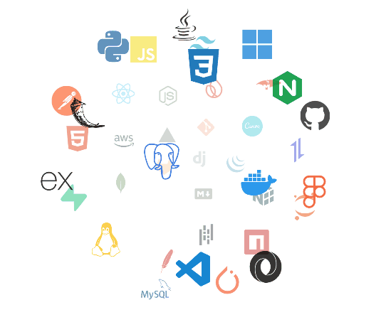

#  ɪ'm lyricss!
*Computer Science Student | Network Engineer in Progress | Linux & Low-Level Enthusiast*
 

I am a Computer Science student passionate about networking, Linux systems, low-level programming and hardware.
I enjoy building and analyzing systems from the network layer to the hardware level - configuring infrastructure,
writing software and exploring how technologies work internally.

- 🌐 **Networking & Infrastructure**: Cisco routing & switching, VLANs, TCP/IP, CCNA concepts, and troubleshooting.
- ⚙️ **Low-Level & C**: Pure C/C++ development, memory management, pointer mechanics, and socket programming.
- 🐧 **Linux & Homelab**: System administration, Docker, Prometheus, Grafana, and self-hosted environments.
- 🔩 **Embedded & Hardware**: ESP32, STM32, Arduino, and communication protocols (UART, SPI, I2C).
- 🔍 **Security & Reverse Engineering**: System analysis, memory inspection, and hardware-level research.

---

<h2 align="center">Tᴇᴄʜ sᴛᴀᴄᴋ & Cᴜʀʀᴇɴᴛ Lᴇᴀʀɴɪɴɢ</h2>

<picture>
  <source media="(prefers-color-scheme: dark)" srcset="./Skills_Animation_Dark.gif">
  <source media="(prefers-color-scheme: light)" srcset="./Skills_Animation_White.gif">
  
</picture>

 

<h3 align="left">Current Learning</h3>

<ul align="left">
  <li>Studying Cisco networking concepts and preparing CCNA-related skills.</li>
  <li>Exploring Linux internals, system administration and server environments.</li>
  <li>Improving C programming skills and understanding low-level software.</li>
  <li>Learning cybersecurity concepts, network security and reverse engineering basics.</li>
  <li>Exploring embedded development and hardware communication protocols.</li>
</ul>

<h3 align="left">My Projects & Experiments</h3>
<ul align="left">
  <li>⚡ <b>TinyWebESP</b>: Pure C static web server library for ESP32 with zero dependencies.</li>
  <li>☎️ PBX & VoIP integration: Siemens HiPath / Optiset hardware setup and telephony routing.</li>
  <li>🌐 Network infrastructure: Cisco switching, VLANs, routing, and Multi-WAN load balancing.</li>
  <li>🐧 Linux & Homelab: Self-hosted services, Docker, and Raspberry Pi / SFF-PC setups.</li>
  <li>💻 Low-level development: C/C++, embedded systems, and socket-level networking.</li>
</ul>

---
